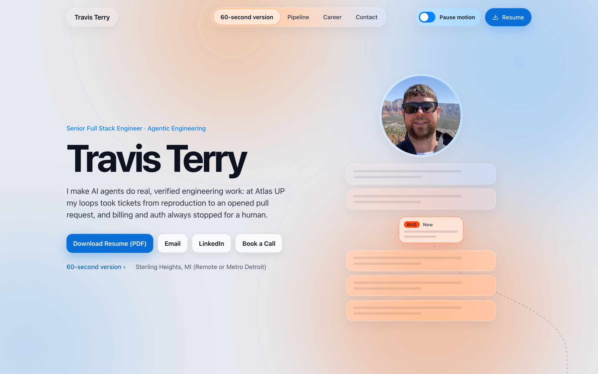

# travisjterry.dev

The source for **[travisjterry.dev](https://travisjterry.dev)**, my resume site. I'm a senior full
stack engineer who builds agentic engineering systems with real guardrails, and this site is built
the same way: every claim is sourced, the AI assistant is grounded and fenced, and the build fails
rather than publish something unconfirmed.

[](https://github.com/travist6983/travis-terry/actions/workflows/deploy.yml)

[](https://travisjterry.dev)

**[Visit the site](https://travisjterry.dev)** ·
[Resume (PDF)](https://travisjterry.dev/resume.pdf) ·
[LinkedIn](https://www.linkedin.com/in/travisjterry) ·
`curl travisjterry.dev/cli`

## What's interesting here

### Ask My Resume: a grounded, rate-limited AI assistant

Visitors can ask questions about my work. The answer path is built to be safe to leave running
unattended:

1. **Deterministic first.** A small classifier in the browser answers common questions from
   pre-approved answers, with no model call at all.
2. **Fenced topics never reach the model.** Salary, confidential employer detail, people, and
   prompt-injection phrasing are caught before any call.
3. **Bot check and rate limits.** Cloudflare Turnstile, then a per-visitor hourly limit keyed on a
   hashed IP (the raw IP is never stored).
4. **Retrieval-augmented generation.** Questions are embedded with Workers AI, matched against a
   Vectorize index of approved content, and answered by Claude using only those sources. The model
   returns structured JSON with the source ids it used, and the site shows the quoted source.
   If the sources don't answer it, it says so instead of guessing.
5. **A hard daily spend cap and a kill switch.** Past the cap, or with the switch off, the site
   falls back to the fixed answers.

Code: [`worker/src/index.ts`](worker/src/index.ts) (the Cloudflare Worker),
[`worker/scripts/ingest.mjs`](worker/scripts/ingest.mjs) (builds the knowledge base),
[`src/components/Ask.tsx`](src/components/Ask.tsx) (the client).

### One sourced content file, many outputs

All copy lives in [`content/content.json`](content/content.json). Each item carries an id and the
source it came from (the resume line, or the decision that approved it). At build time,
[`scripts/build-resume-files.mjs`](scripts/build-resume-files.mjs) generates `resume.md`,
`resume.txt`, a [JSON Resume](https://jsonresume.org) `resume.json`, `llms.txt` and the `curl`
version from the same strings, so the site, the machine-readable resumes and the assistant's
knowledge base can never disagree. A missing id or an unconfirmed item fails the build.

### Motion with an off switch

The page tells the story of a ticket moving through an agent pipeline with scroll-driven animation
(GSAP and Lenis). It respects `prefers-reduced-motion`, and a visible **Pause motion** toggle stops
all of it.

## Stack

| Part | Tech |
|---|---|
| Site | Next.js 15 (static export), React 19, TypeScript, GSAP, Lenis |
| Assistant | Cloudflare Workers, Workers AI embeddings, Vectorize, KV, Turnstile, Anthropic Claude |
| Hosting | GitHub Pages, deployed by GitHub Actions on every push to `main` |

## Run it locally

```bash
npm install
npm run dev        # http://localhost:3000 (generates the resume files first)
npm run build      # static export to dist/
```

The Ask box works without the Worker, using the approved answers only. To run the Worker, see
`worker/wrangler.toml`; it needs Cloudflare and Anthropic credentials of your own.

## Contact

The quickest way to reach me is the **Email** button on [travisjterry.dev](https://travisjterry.dev),
or [LinkedIn](https://www.linkedin.com/in/travisjterry).
