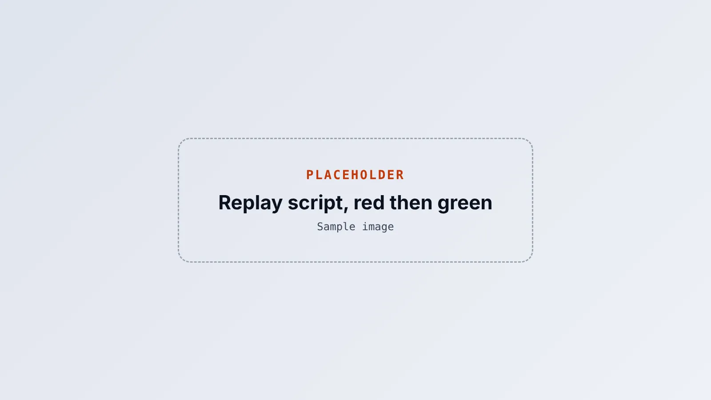

*This is a sample post. It shows the build log format by retelling one part of "The model never changes. The loop around it does." It isn't a separate report.*

## The problem

A coding agent that grades its own work will call a change done the moment something turns green. A success toast or a log line that says "fixed" looks like proof, and it isn't.

## What the kit did

In the defect loop, the evaluator comes first. Before anything gets fixed, the repro step records the bug in a browser and writes a replay script that has to fail on the broken build. Later, the verify step runs that same script, and it has to flip from red to green.

```text defect-loop.recipe
intake → repro → fix → verify ∥ regression → pre-pr → ship → prod-verify
```



## What broke

The first dry run against a real project found that macOS's built-in bash 3.2 mangled the JavaScript braces in the replay script's sign-in check, so the check never matched. The evaluator built to catch false passes was itself failing quietly.

## What I changed

```fixes
@@ replay oracle @@ [commit 1cd85ec](https://github.com/travist6983/agent-kit/commit/1cd85ec)
- **The replay script failed on a Mac.** bash 3.2 mangled the sign-in check's JavaScript braces.
+ **The oracle runs on old bash.** The sign-in check's JavaScript now sits in variables before it's quoted, so bash 3.2 leaves it alone.
```

> $ git commit -m
> Only the state the agent reads back counts.
