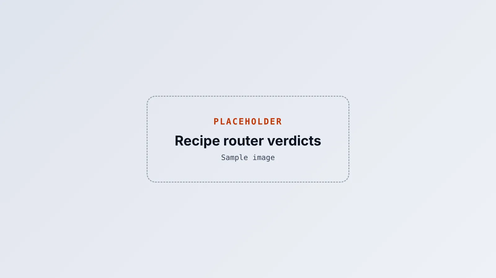

*This is a sample post. It shows the build log format by retelling one part of "The model never changes. The loop around it does." It isn't a separate report.*

## The problem

When a coding agent is wrong, it tends to try the same idea again in different words. A retry that changes nothing is just the same failure, slower.

## What the kit did

When a step fails, the failure gets a class before anything else happens:

- A regression in the same area goes back to the fix step.
- A break in an unrelated area escalates to a person.
- A flaky test gets quarantined.

That routing lives in a small tested Python script, recipe_router.py, so the decision comes out the same every time instead of being whatever the model feels like on that turn.

## What broke

This sample has no failure of its own. The five real ones are in "The model never changes. The loop around it does."

## What I changed

Nothing yet. This post exists to show the list, the graph and the pager with more than one commit.
