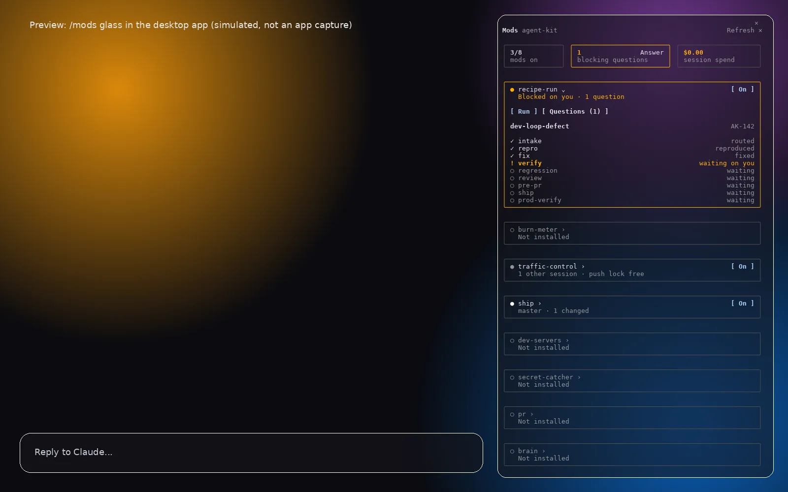
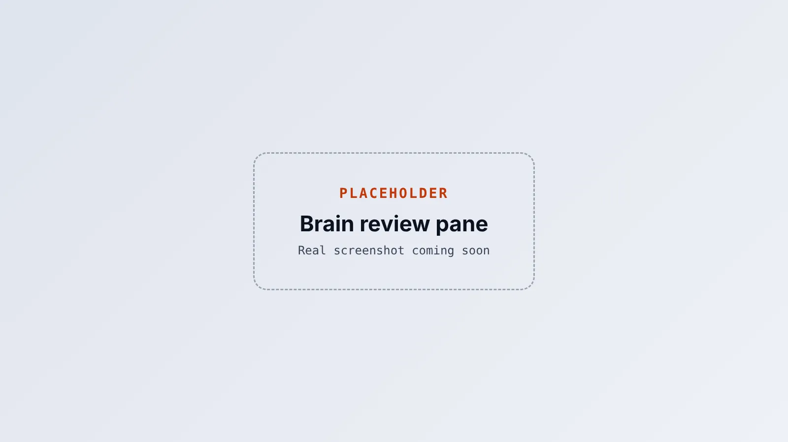

## The problem

Coding agents tend to fail the same way, and it's rarely the model's fault. The agent reads a bug, makes a change, sees something green and says it's done. When it's wrong, it tries the same idea again in different words. When it's right, nothing it learned carries over to the next ticket.

A smarter model doesn't fix that. The system around the model has to know what "done" means, notice why an attempt failed, and remember what worked. That's the idea behind agent-kit, the set of Claude Code skills, recipes and mods I started in October. The line at the top of its README comes from Vikas Gupta's writing on loop engineering: self improvement is loop evolution, not model evolution.

## What the kit did

Every agent in the kit is a loop, not a prompt. A loop is a thin recipe that strings small skills together, with a gate between every step and a written contract for what each step hands to the next. The kit has 36 skills and recipes built this way.

The reference loop is the defect loop:

```text defect-loop.recipe
intake → repro → fix → verify ∥ regression → pre-pr → ship → prod-verify
```

Three rules hold it together.

**The evaluator comes first.** Before anything gets fixed, the repro step records the bug in a browser and writes a replay script that has to fail on the broken build. Later, the verify step runs that same script, and it has to flip from red to green. A success toast or a log line that says "fixed" never counts. Only the state the agent reads back does.

**A retry has to change something.** When a step fails, the failure gets a class before anything else happens. A regression in the same area goes back to the fix step. A break in an unrelated area escalates to me. A flaky test gets quarantined. That routing lives in a small tested Python script, recipe_router.py, so the decision comes out the same every time instead of being whatever the model feels like on that turn.

**Every run teaches the next one.** A shared brain in Postgres with pgvector holds selectors, flaky test history and fix lessons (symptom, root cause, fix shape). The agent writes mechanical knowledge on its own. Anything that's judgment, like how a feature should behave, it can only propose, and a person has to bless it.

A second loop uses the same pattern to get an agent up to speed on a codebase it has never seen. A script surveys the repo with no model involved. Then two readers per area write cited claims: one on how the code works, one on why it was built that way, taken from commits and decision docs. Three separate agents then run a blind quiz. One writes questions from the code, one answers using only the map, and one grades. A script checks every citation against the real files. Each question the map missed becomes a relearn job for that one area, and only verified claims go back into the brain.

Around the loops sit 11 Claude Code mods. Two matter here: a run pane that shows a recipe's stages live, and an inbox for the questions a loop is blocked on.



## What broke

Five failures from the commit history:

**A fix could hide the bug and still pass.** Nothing stopped the fix step from guarding a bad state right where it crashed. The tests would go green, but if that state should never exist, the guard only buries the real bug one layer down. The verify step also had no proof that a change left nearby behavior alone.

**A built-in command took a mod down.** Claude Code added its own /workflows command. My burn-meter mod registered a command with the same name, the registration threw, and the mod's whole startup got skipped. No status line, no limits, and nothing that said why.

**A whole loop never reached main.** I built the onboarding loop as a stack of six pull requests. After the first one merged and its branch was deleted, the next four merged into their stacked bases instead of main. The map, the recipe and the teaching step all showed as merged and still weren't on main.

**One letter blanked a pane.** The brain mod's review pane opened empty every time. Its render code named a value h, which shadowed the JSX factory that's also called h. Every render threw "h is not a function," and the pane just drew nothing.

**The replay script failed on a Mac.** The first dry run against a real project found that macOS's built-in bash 3.2 mangled the JavaScript braces in the replay script's sign-in check, so the check never matched. The evaluator I'd built to catch false passes was itself failing quietly.

## What I changed

None of these failed loudly, so every fix turns a quiet failure into a loud one.

```fixes
@@ fix step @@ [PR 1](https://github.com/travist6983/agent-kit/pull/1)
- **A fix could hide the bug and still pass.** Nothing stopped the fix step from guarding a bad state right where it crashed.
+ **Root cause, proven.** The fix step now traces the symptom back to the first wrong decision in the code and asks whether the state that triggered it is legitimate. If it isn't, the fix has to go where that state was produced, and the contract validator refuses a fix that still guards at the symptom. Verify now hands only the diff to a fresh sub agent that has to prove nothing nearby changed, without seeing the fixer's reasoning. A new skill, dev-harden, turns a correction that keeps coming back into a check the pre-PR step enforces. The root cause trace and the collateral proof are adapted from Lauren Tan's pstack (MIT).
@@ mods @@ [PR 10](https://github.com/travist6983/agent-kit/pull/10)
- **A built-in command took a mod down.** Claude Code added its own /workflows command. My burn-meter mod registered a command with the same name, the registration threw, and the mod's whole startup got skipped.
+ **One refused name can't sink a mod.** The switch is now /fanout off and on, each command registers on its own, and new tests fail on the old code.
@@ stacked PRs @@ [PR 3](https://github.com/travist6983/agent-kit/pull/3)
- **A whole loop never reached main.** After the first one merged and its branch was deleted, the next four merged into their stacked bases instead of main.
+ **Main is the source of truth.** I merged the missing pieces into the PR that was still open so it carried the whole loop to main, then checked main for every stage. A merged badge on a stacked PR says nothing about main.
@@ panes @@ [PR 13](https://github.com/travist6983/agent-kit/pull/13)
- **One letter blanked a pane.** Its render code named a value h, which shadowed the JSX factory that's also called h.
+ **Panes get a mount test.** The variable is renamed, and a new test mounts the review pane with a proposed lesson, so a render that throws fails the suite instead of drawing a blank.
@@ replay oracle @@ [commit 1cd85ec](https://github.com/travist6983/agent-kit/commit/1cd85ec)
- **The replay script failed on a Mac.** The first dry run against a real project found that macOS's built-in bash 3.2 mangled the JavaScript braces in the replay script's sign-in check, so the check never matched.
+ **The oracle runs on old bash.** The sign-in check's JavaScript now sits in variables before it's quoted, so bash 3.2 leaves it alone.
```



Some of it is still unproven, and the kit says so. The defect loop's consumption cap is a declared limit with a tested comparator, and the limits file states plainly that it isn't an enforced gate until a runner feeds it real numbers. Every production loop stays dry run and staging only until four safety gates exist in the stack it runs against. The onboarding quiz's pass marks are starting numbers too, not measured ones.

> $ git commit -m
> The model doesn't learn anything between runs. The loop around it does.

## Try it

Start with docs/loop-engineering.md in [agent-kit](https://github.com/travist6983/agent-kit). It's the rubric every skill is held to, and it's a lot shorter than the code.
