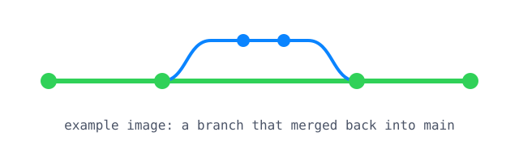

Open with one or two sentences of context: what you were building and why this run is worth a post.

## The problem

Say what you set out to do and what "done" meant. Keep it to the facts a reader needs to follow the rest.

## What the kit did

Walk through what the agent kit actually did, step by step. Short code or config excerpts help:

```ts
// Fenced code blocks keep their language tag as a class (language-ts).
const result = await runPipeline({ ticket, guardrails: 'strict' });
```

Images live in `logs/img/` and use a relative path and alt text:



## What broke

Name the failure plainly: what you saw, what it cost, and how you found it.

## What I changed

The fix, and the guardrail you added so it can't happen again. Link the commit or PR if it's public.
